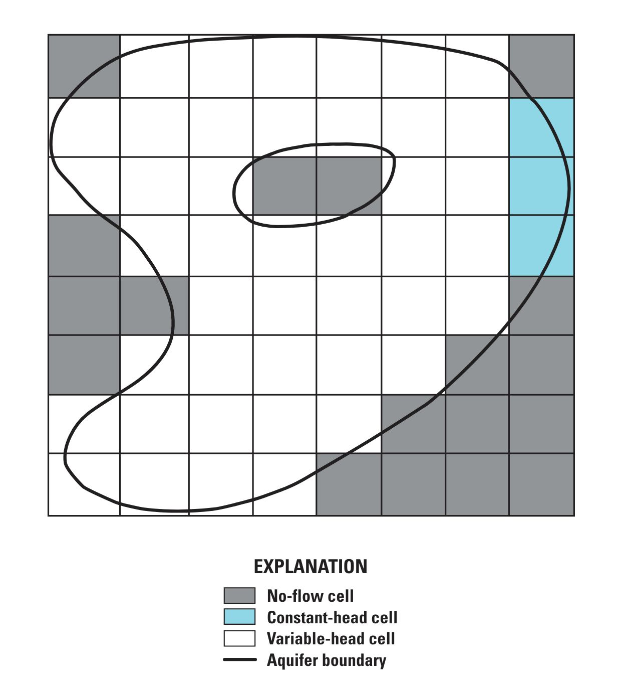

```{python}
#| echo: false
#| include: false
# Runs the same models as labs/week08/week08_01_discretization_boundaries.ipynb
# at render time, so the figures and numbers on the slides are the ones students
# get in the notebook.
from pathlib import Path

import flopy
import matplotlib.pyplot as plt
import numpy as np
from scipy import ndimage
from scipy.interpolate import RegularGridInterpolator

ROOT = Path.cwd().parent
MF_EXE = ROOT / "modflow" / "mf2005"
assert MF_EXE.exists(), f"MODFLOW binary not found at {MF_EXE}. Run ./postbuild.sh."
RUN = ROOT / "_run"
NROW, NCOL, DELR = 40, 60, 250.0
EXTENT = [0, 15, 0, 10]
land = np.loadtxt(ROOT / "data" / "tucson_srtm_250m.csv", delimiter=",")


def confined_box(cell_size):
    ncol, nrow = int(15000 / cell_size), int(10000 / cell_size)
    ws = RUN / f"week08_slides_{int(cell_size)}"
    ws.mkdir(parents=True, exist_ok=True)
    mf = flopy.modflow.Modflow("box", model_ws=str(ws), exe_name=str(MF_EXE))
    flopy.modflow.ModflowDis(mf, 1, nrow, ncol, delr=cell_size, delc=cell_size,
                             top=600.0, botm=400.0, nper=1, steady=True)
    ib = np.ones((1, nrow, ncol), dtype=int)
    ib[:, :, 0] = -1
    ib[:, :, -1] = -1
    strt = np.full((1, nrow, ncol), 660.0)
    strt[:, :, 0] = 620.0
    strt[:, :, -1] = 700.0
    flopy.modflow.ModflowBas(mf, ibound=ib, strt=strt)
    flopy.modflow.ModflowLpf(mf, hk=12.0, laytyp=0, ipakcb=53)
    wr, wc = int(5000 / cell_size), int(7500 / cell_size)
    flopy.modflow.ModflowWel(mf, stress_period_data={0: [[0, wr, wc, -20000.0]]},
                             ipakcb=53)
    flopy.modflow.ModflowRch(mf, rech=1.2e-4, ipakcb=53)
    flopy.modflow.ModflowPcg(mf)
    flopy.modflow.ModflowOc(mf, stress_period_data={(0, 0): ["save head", "save budget"]})
    mf.write_input()
    ok, buff = mf.run_model(silent=True, report=True)
    assert ok, "\n".join(buff[-15:])
    h = flopy.utils.HeadFile(str(ws / "box.hds")).get_data()
    y = (np.arange(nrow) + 0.5) * cell_size
    x = (np.arange(ncol) + 0.5) * cell_size
    near = float(RegularGridInterpolator((y, x), h[0])([5000.0, 6500.0])[0])
    return {"n": h[0].size, "well": float(h[0, wr, wc]), "near": near}


def basin_model(ibound, name):
    ws = RUN / f"week08_slides_{name}"
    ws.mkdir(parents=True, exist_ok=True)
    mf = flopy.modflow.Modflow("basin", model_ws=str(ws), exe_name=str(MF_EXE))
    flopy.modflow.ModflowDis(mf, 1, NROW, NCOL, delr=DELR, delc=DELR,
                             top=600.0, botm=400.0, nper=1, steady=True)
    flopy.modflow.ModflowBas(mf, ibound=ibound, strt=np.full((1, NROW, NCOL), 620.0))
    flopy.modflow.ModflowLpf(mf, hk=12.0, laytyp=0, ipakcb=53)
    flopy.modflow.ModflowWel(mf, stress_period_data={0: [[0, 20, 30, -20000.0]]},
                             ipakcb=53)
    flopy.modflow.ModflowRch(mf, rech=1.2e-4, ipakcb=53)
    flopy.modflow.ModflowPcg(mf)
    flopy.modflow.ModflowOc(mf, stress_period_data={(0, 0): ["save head", "save budget"]})
    mf.write_input()
    ok, _ = mf.run_model(silent=True, report=True)
    return ok, flopy.utils.HeadFile(str(ws / "basin.hds")).get_data()


grid = {s: confined_box(s) for s in [500.0, 250.0, 125.0]}

ibound = np.ones((1, NROW, NCOL), dtype=int)
ibound[0][land > 850.0] = 0
ibound[:, :, 0] = -1
ok_first, head_first = basin_model(ibound, "basin_first")

regions, n_regions = ndimage.label(ibound[0] != 0)
cells_per_region = np.array([(regions == k).sum() for k in range(1, n_regions + 1)])
main_region = int(cells_per_region.argmax()) + 1
ibound_fixed = ibound.copy()
ibound_fixed[0][regions != main_region] = 0
ok_fixed, head_fixed = basin_model(ibound_fixed, "basin_fixed")
assert ok_fixed and not ok_first

plt.rcParams.update({"font.size": 13, "figure.dpi": 130})
UA_RED, UA_BLUE = "#AB0520", "#0C234B"
IB_CMAP = plt.matplotlib.colors.ListedColormap([UA_RED, "#E2E9EB", "#1E5288"])
```

## Today {.smaller}

::: {.kicker}
Week 8, session 1 of 2
:::

1. Quiz, five minutes
2. This week's model: part of the Tucson basin
3. How small do the cells need to be?
4. `ibound`: active, inactive, and constant-head cells
5. Checking that the active cells are connected

We're working through `week08_01_discretization_boundaries.ipynb`. Open it now
and run cells as we go.

# The model {background-color="#0C234B"}

## A bigger model than last week

```{python}
#| echo: false
#| fig-width: 9
#| fig-height: 4.4
fig, ax = plt.subplots(figsize=(9, 4.4))
im = ax.imshow(land, cmap="terrain", extent=EXTENT)
fig.colorbar(im, ax=ax, label="land surface (m)", shrink=0.9)
ax.set_xlabel("distance east (km)")
ax.set_ylabel("distance north (km)")
plt.tight_layout()
plt.show()
```

15 km by 10 km on the north side of the Tucson basin. Land surface is from
SRTM, averaged onto 250 m cells: 40 rows, 60 columns.

## What's in it

| | |
|---|---|
| Layer | one, confined, top at 600 m, bottom at 400 m |
| Hydraulic conductivity | 12 m/d |
| West edge | constant head, 620 m |
| East edge | constant head, 700 m |
| Recharge | 1.2e-4 m/d everywhere |
| Well | 20,000 m³/d, 7.5 km east and 5 km south of the NW corner |

::: {.fragment}
Same packages as Week 7, plus `RCH` for recharge. For the first half of today
we ignore the mountains and treat the whole rectangle as aquifer.
:::

# Cell size {background-color="#AB0520"}

## Why 250 m?

A smaller cell gives a more detailed answer and a slower model. So how do you
know when the cells are small enough?

::: {.fragment}
Run the same problem at two or three cell sizes and compare. If the answer
stops changing, the cells are small enough.
:::

::: {.fragment}
Keep the problem the same on the ground. The well stays 7.5 km east and 5 km
south of the corner, so its row and column change with the cell size.
:::

## Three cell sizes

```{python}
#| echo: false
print(f"{'cell size':>10s} {'cells':>8s} {'well cell':>12s} {'1 km west of well':>20s}")
for s in sorted(grid, reverse=True):
    g = grid[s]
    print(f"{s:8.0f} m {g['n']:8,d} {g['well']:10.3f} m {g['near']:18.3f} m")
```

::: {.incremental}
- One kilometre from the well, the head changes by a few centimetres
- In the well cell, it changes by more than a metre each time
:::

## The two heads behave differently

```{python}
#| echo: false
#| fig-width: 10
#| fig-height: 3.4
sizes = sorted(grid, reverse=True)
n_cells = [grid[s]["n"] for s in sizes]
fig, axes = plt.subplots(1, 2, figsize=(10, 3.4))
axes[0].plot(n_cells, [grid[s]["well"] for s in sizes], "o-", color=UA_RED, ms=7)
axes[0].set_title("Head in the well cell")
axes[1].plot(n_cells, [grid[s]["near"] for s in sizes], "s-", color=UA_BLUE, ms=7)
axes[1].set_title("Head 1 km west of the well")
for ax in axes:
    ax.set_xscale("log")
    ax.set_xlabel("number of cells")
    ax.set_ylabel("head (m)")
    ax.grid(alpha=0.3)
span = np.ptp(axes[0].get_ylim())
axes[1].set_ylim(grid[250.0]["near"] - span / 2, grid[250.0]["near"] + span / 2)
plt.tight_layout()
plt.show()
```

Both panels have the same vertical span.

## Why the well cell keeps changing

Head near a well depends on the log of the distance from it:

$$h(r) = h_0 + \frac{Q}{2\pi T}\ln\frac{r}{r_0}$$

::: {.fragment}
MODFLOW gives one head per cell. A smaller cell represents a region closer to
the well, so its head is lower.
:::

::: {.fragment}
Each time the cell size is halved, the well-cell head drops by about
$\frac{Q}{2\pi T}\ln 2$. Here that is about 0.9 m. It does not go to zero.
:::

## What this means in practice

::: {.incremental}
- The head in a pumping cell is **not** the water level in the well. The water
  level in the well is lower.
- To estimate the level in the well, use an analytical correction or a much
  finer grid around the well.
- To decide whether the grid is fine enough, look at heads away from the wells
  and at the water budget.
:::

## Your turn: has it converged?

Heads 1 km west of the well at three cell sizes. Work out the two changes and
whether the second is smaller than the first.

```{pyodide}
#| setup: true
#| exercise: ex_converge
near = {500.0: 652.463, 250.0: 652.401, 125.0: 652.367}
```

```{pyodide}
#| exercise: ex_converge
change_1 = near[250.0] - near[500.0]
change_2 = ______
shrinking = ______
print(f"500 -> 250 m : {change_1:+.3f} m")
print(f"250 -> 125 m : {change_2:+.3f} m")
print(f"second change smaller? {shrinking}")
```

::: {.hint exercise="ex_converge"}
::: {.callout-note collapse="false"}
## Hint

Compare the sizes of the changes, not their signs. Use `abs()` on both.
:::
:::

::: {.solution exercise="ex_converge"}
::: {.callout-tip collapse="false"}
## Solution

```python
change_2 = near[125.0] - near[250.0]
shrinking = abs(change_2) < abs(change_1)
```

The changes are −0.062 m and −0.034 m. Each is about half the one before, so
the next would be under 2 cm. For most purposes 250 m is fine here.

If the second change were as big as the first, you would need smaller cells.
:::
:::

## Your turn: pick a cell size

A rule of thumb: put at least 8 cells across the smallest feature you care
about. You want to see a cone of depression about 2 km across in a 15 km by
10 km domain.

```{pyodide}
#| setup: true
#| exercise: ex_cellsize
cone_width_m = 2000.0
domain_x, domain_y = 15000.0, 10000.0
cells_across_cone = 8
```

```{pyodide}
#| exercise: ex_cellsize
max_cell_size = ______
n_cells = ______
print(f"cell size no larger than {max_cell_size:.0f} m")
print(f"that is {n_cells:,.0f} cells in one layer")
```

::: {.hint exercise="ex_cellsize"}
::: {.callout-note collapse="false"}
## Hint

Divide the feature width by the number of cells you want across it. Then work
out how many cells of that size fit in each direction.
:::
:::

::: {.solution exercise="ex_cellsize"}
::: {.callout-tip collapse="false"}
## Solution

```python
max_cell_size = cone_width_m / cells_across_cone
n_cells = (domain_x / max_cell_size) * (domain_y / max_cell_size)
```

250 m cells, and 2,400 of them. That is the grid we are using.
:::
:::

# `ibound` {background-color="#0C234B"}

## Three values

| Value | Meaning | Head |
|---|---|---|
| `1` | active | calculated by MODFLOW |
| `0` | inactive | not calculated; the cell is not in the model |
| `-1` | constant head | fixed at the value in `strt` |

::: {.fragment}
You set `ibound` in the `BAS` package. In Week 7 it was all ones, with `-1` down
the left and right edges.
:::

<!-- Figure recovered from old_slides/hwrs564a_oct23.pdf, p. 12. -->
## The grid is a rectangle. The aquifer is not. {.smaller}

::: {.columns}
::: {.column width="47%"}
{fig-alt="A rectangular groundwater model grid with no-flow cells outside an aquifer boundary, constant-head cells at an edge, and variable-head cells inside" width="88%"}
:::

::: {.column width="53%"}
::: {.incremental}
- The black line is the edge of the aquifer
- Grey cells are inactive (`0`)
- Blue cells are constant head (`-1`)
- White cells are active (`1`)
:::

::: {.fragment}
An active cell next to an inactive cell has a no-flow boundary on that side.
You do not have to set that up. It follows from `ibound`.
:::
:::
:::

## `ibound = 0` is not `hk = 0`

::: {.incremental}
- An inactive cell is left out of the equations
- A cell with `hk = 0` is still in the equations and still gets a head
- Cells like that can slow the solver or stop it converging
:::

::: {.fragment}
To leave rock out of the model, use `ibound = 0`.
:::

## Cutting out the mountains

We don't have a map of where the basin fill ends. As a stand-in: any cell with
land surface above 850 m is bedrock.

```python
ibound = np.ones((1, NROW, NCOL), dtype=int)
ibound[0][land_surface > 850.0] = 0     # bedrock
ibound[:, :, 0] = -1                    # constant head on the west edge
```

::: {.fragment}
The east edge is mostly mountain front now, so we leave it as no-flow and keep
constant head on the west edge only.
:::

## The result

```{python}
#| echo: false
#| fig-width: 9
#| fig-height: 4.2
fig, ax = plt.subplots(figsize=(9, 4.2))
im = ax.imshow(ibound[0], cmap=IB_CMAP, vmin=-1.5, vmax=1.5, extent=EXTENT)
cb = fig.colorbar(im, ax=ax, ticks=[-1, 0, 1], shrink=0.9)
cb.ax.set_yticklabels(["-1 constant head", "0 inactive", "1 active"])
ax.set_xlabel("distance east (km)")
ax.set_ylabel("distance north (km)")
plt.tight_layout()
plt.show()
```

```{python}
#| echo: false
print(f"{int((ibound == 1).sum())} active, {int((ibound == 0).sum())} inactive, "
      f"{int((ibound == -1).sum())} constant head")
```

## Run it

```{python}
#| echo: false
print(f"success = {ok_first}")
print(f"highest head in an active cell: {head_first[0][ibound[0] == 1].max():,.0f} m")
```

::: {.fragment}
The run fails, and the highest head is hundreds of kilometres up.
:::

::: {.fragment}
Look at the east edge of the map again. A few small patches of active cells are
surrounded by inactive ones. They get recharge and have nowhere to send it.
:::

## Finding cut-off cells

MODFLOW moves water only between cells that share a face. Cells that touch at a
corner are not connected.

```python
from scipy import ndimage

in_model = ibound[0] != 0                      # active or constant head
regions, n_regions = ndimage.label(in_model)
```

::: {.fragment}
`ndimage.label` numbers each group of connected cells 1, 2, 3, ... and uses the
same shared-face rule.
:::

```{python}
#| echo: false
print(f"{n_regions} separate regions, with {cells_per_region.tolist()} cells")
```

## Your turn: how many cells are cut off?

```{pyodide}
#| setup: true
#| exercise: ex_connect
import numpy as np
cells_per_region = np.array([1633, 8, 2, 1])
```

```{pyodide}
#| exercise: ex_connect
main_region = ______           # region numbers start at 1
n_cut_off = ______
print(f"main region: {main_region}")
print(f"cells cut off from it: {n_cut_off}")
```

::: {.hint exercise="ex_connect"}
::: {.callout-note collapse="false"}
## Hint

`argmax()` gives the position of the largest value, counting from 0. The
cut-off cells are everything that is not in the largest region.
:::
:::

::: {.solution exercise="ex_connect"}
::: {.callout-tip collapse="false"}
## Solution

```python
main_region = int(cells_per_region.argmax()) + 1
n_cut_off = int(cells_per_region.sum() - cells_per_region.max())
```

Region 1 is the basin. Eleven cells in three small patches are cut off from it.
:::
:::

## Remove them and run again

```python
ibound_fixed = ibound.copy()
ibound_fixed[0][regions != main_region] = 0
```

```{python}
#| echo: false
#| fig-width: 9
#| fig-height: 3.9
head_plot = np.where(ibound_fixed[0] == 0, np.nan, head_fixed[0])
fig, ax = plt.subplots(figsize=(9, 3.9))
im = ax.imshow(head_plot, cmap="Blues_r", extent=EXTENT)
fig.colorbar(im, ax=ax, label="head (m)", shrink=0.9)
ax.contour(np.flipud(head_plot), levels=8, colors="k", linewidths=0.6, extent=EXTENT)
ax.set_xlabel("distance east (km)")
ax.set_ylabel("distance north (km)")
plt.tight_layout()
plt.show()
```

```{python}
#| echo: false
active = head_fixed[0][ibound_fixed[0] != 0]
print(f"success = {ok_fixed}, head {active.min():.1f} to {active.max():.1f} m")
```

## Check this every time

::: {.incremental}
- MODFLOW reported a solver failure. It did not say the cells were cut off.
- Without recharge on those cells, the run would have succeeded and they would
  have kept their starting head.
- Run the connectivity check whenever you build or change `ibound`.
- Mask inactive cells before you plot heads. They hold a placeholder value,
  `hnoflo`, in the head file.
:::

## Wrap up {.smaller}

::: {.kicker}
What you did today
:::

- Ran one problem at three cell sizes and compared the answers
- Saw why the head in a pumping cell is not the water level in the well
- Used `ibound` to make part of the grid inactive
- Found cells that were cut off from the model and removed them

::: {.kicker}
Before Thursday
:::

- Finish `labs/week08/week08_01_discretization_boundaries.ipynb`

::: {.kicker}
Thursday
:::

Unconfined flow, a model that does not converge with the default solver
settings, and dry cells. Then a first look at the Pinal County model for
Project 3.
