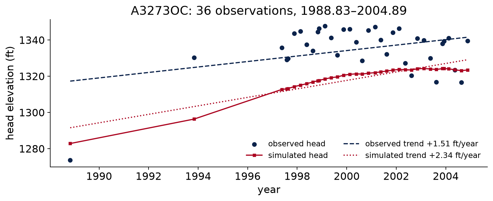
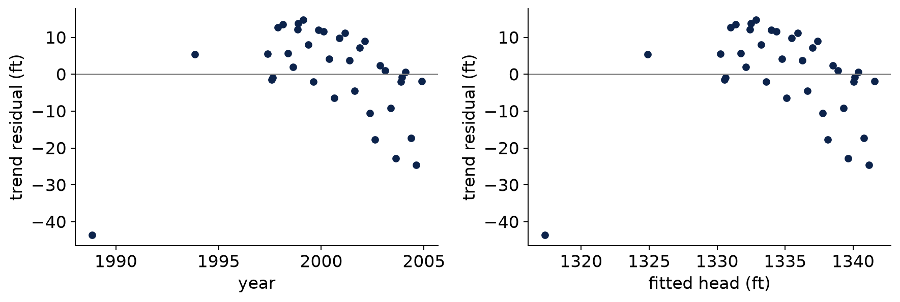
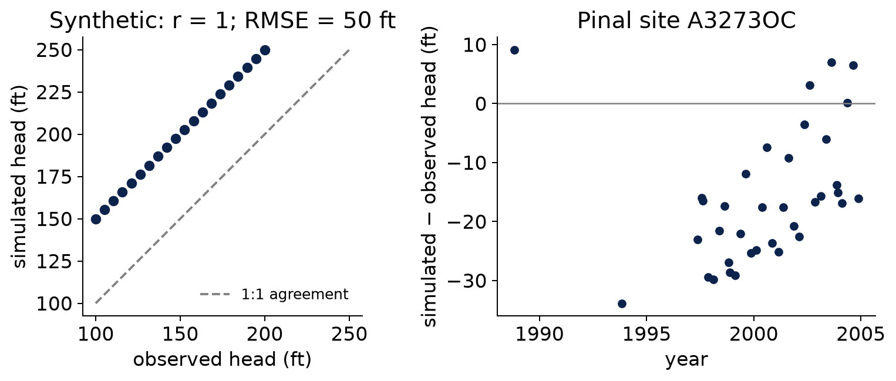

## Recovery slopes and model errors

Tuesday: mean recovery-slope difference **+1.44 ft/year** across 191 qualifying sites.

Today: what the fitted slopes summarize, what the errors reveal, and what evidence supports model use.

Open [Lab 2 — Regression and evaluation](../labs/week13/week13_02_regression_evaluation.ipynb).

The notebook starts independently of Tuesday's work.

::: {.notes}
0–8 minutes: retrieval check. Ask what the +1.44 means, what the bootstrap resampled, and why its interval was illustrative. Today's progression: 12 min linear models; 15 min fitting one site; 15 min diagnostics; 15 min head-error metrics; 10 min final assessment. The site was selected to expose uneven sampling and limitations of a single rate, not as a representative well.
:::

# The fitted trend {background-color="#0C234B"}

## A straight-line mean model

$$h_i=a+b(t_i-1985)+\epsilon_i$$

| Quantity | Meaning | Units |
|---|---|---|
| $a$ | Fitted head at 1985 | ft |
| $b$ | Average linear rate of head change | ft/year |
| $\epsilon_i$ | Departure from the linear mean model | ft |

A positive slope means rising **head elevation**.

::: {.notes}
8–20 minutes. Centering the time variable gives the intercept a useful reference year. For A3273OC the first eligible observation is 1988.83, so the fitted 1985 head is an extrapolated intercept. Contrast with depth to water, whose sign is reversed. A line summarizes a period; it is not a groundwater flow equation.
:::

## Least squares chooses the line

$$\min_{a,b}\sum_i\left[h_i-\{a+b(t_i-1985)\}\right]^2$$

The fitted line minimizes squared **vertical** residuals.

```python
import numpy as np
year = np.array([1985., 1990., 1995., 2000.])
head = np.array([100., 110., 120., 130.])
b, a = np.polyfit(year - 1985, head, 1)
fitted = a + b * (year - 1985)
```

Fitting a line and deciding whether it is adequate are separate tasks.

## Your turn: recover a trend

Illustrative data. Reproduce a real site's slopes in **Lab 2, task 1**.

```{pyodide}
#| exercise: ex_slope
import numpy as np
year = np.array([1985., 1990., 1995., 2000.])
head = np.array([100., 110., 120., 130.])

x = year - 1985
b, a = np.polyfit(______, ______, 1)
print("slope (ft/year):", b)
print("head at 1985 (ft):", a)
```

::: {.hint exercise="ex_slope"}
The predictor is years since 1985; the response is head elevation.
:::

::: {.solution exercise="ex_slope"}
```python
import numpy as np
year = np.array([1985., 1990., 1995., 2000.])
head = np.array([100., 110., 120., 130.])

x = year - 1985
b, a = np.polyfit(x, head, 1)
print("slope (ft/year):", b)
print("head at 1985 (ft):", a)
```
Slope +2 ft/year; intercept 100 ft.
:::

::: {.notes}
20–35 minutes: lab task 1. The real site has 36 observations over about 16 years. Fit observed and simulated heads using exactly the same x values. Do not imply one site's gap must agree in sign with the overall mean.
:::

## One slope summarizes an uneven history

{fig-alt="Observed and simulated heads at site A3273OC with fitted trends, showing uneven sampling and variation around the observed trend." width="90%"}

What does the early observation contribute to each fitted rate?

## The slope from centered sums

For $x_i=t_i-1985$,

$$b=\frac{\sum_i(x_i-\bar x)(h_i-\bar h)}{\sum_i(x_i-\bar x)^2},\qquad a=\bar h-b\bar x.$$

The numerator measures how time and head vary together.

The denominator measures the spread of observation times.

An isolated early point can strongly influence the slope.

::: {.notes}
This formula explains the regression; students need not reimplement it during the lab. Connecting np.polyfit to the least-squares objective is enough. If time permits, predict what removing the earliest point would do before demonstrating sensitivity. Do not remove it simply because it changes the answer.
:::

# Diagnostics {background-color="#AB0520"}

## Trend residuals describe departures from the line

$$r_i=h_{obs,i}-\widehat h_{trend,i}$$

{fig-alt="Observed trend residuals plotted against year and fitted head to inspect structure and spread." width="90%"}

**Lab 2, task 2:** look for curvature, changing spread, and runs of the same sign.

::: {.notes}
35–50 minutes. Residuals from an OLS line with an intercept average approximately zero by construction. This does not show that the physical groundwater model is unbiased. Patterns through time can show that a constant slope is inadequate.
:::

## Dependent observations share information

Closely spaced measurements can reflect the same aquifer conditions.

Illustrative observations at irregular times:

```python
import numpy as np
year = np.array([1985., 1986., 1989., 1990., 1995.])
head = np.array([100., 104., 111., 109., 118.])
b, a = np.polyfit(year - 1985, head, 1)
residual = head - (a + b * (year - 1985))
adjacent_r = np.corrcoef(residual[:-1], residual[1:])[0, 1]
```

For irregular observation times, this measures **adjacent-record correlation**, not fixed-lag annual autocorrelation.

A small value does not prove independence. Ordinary slope intervals and row-wise bootstraps can be misleading when errors are dependent.

::: {.notes}
The reference course examines autocorrelation using regularly sampled temperature data. Here we retain the actual irregular Pinal times and name the adjacent-record calculation accurately. Do not present the result as a validated hypothesis test. An optional equally spaced synthetic demonstration appears in the instructor guide.
:::

## Mean response and individual prediction

**Confidence interval for a fitted mean:** uncertainty about the line's mean response at a given time.

**Prediction interval for a new observation:** also includes scatter around that mean; generally wider under the same model.

Both rely on assumptions about the statistical model.

Neither automatically represents uncertainty in every future MODFLOW scenario.

::: {.notes}
Keep this distinction conceptual. Standard formulas usually assume an adequate linear mean and independent errors, with additional conditions for exact intervals. The lab deliberately does not compute a nominal slope interval after diagnosing potentially inadequate errors. A straight line extrapolated to 2115 is not a calibrated groundwater forecast.
:::

# Evaluating simulated heads {background-color="#0C234B"}

## Head error has a different definition

$$e_i=h_{sim,i}-h_{obs,i}$$

| Quantity | Comparison | Positive means |
|---|---|---|
| Tuesday's slope gap | Observed slope − simulated slope | Smaller simulated recovery slope |
| Trend residual | Observed head − fitted trend | Observation above the line |
| Model head error | Simulated head − observed head | Simulated head too high |

Units and subtraction order belong beside the result.

::: {.notes}
50–65 minutes. Ask students to explain how the same simulation can have a positive slope discrepancy at one site and still have errors of either sign. Avoid discussing these three different quantities under an undefined generic label of residual.
:::

## Your turn: bias, MAE, and RMSE

**Lab 2, task 3** applies these definitions to the selected well.

```{pyodide}
#| exercise: ex_metrics
import numpy as np
e = np.array([-4., -2., 0., 2., 4.])

bias = ______
mae = ______
rmse = ______
print(bias, mae, rmse)
```

::: {.hint exercise="ex_metrics"}
Average the signed errors, their absolute values, and their squares. Take the square root of the last average.
:::

::: {.solution exercise="ex_metrics"}
```python
import numpy as np
e = np.array([-4., -2., 0., 2., 4.])

bias = e.mean()
mae = np.abs(e).mean()
rmse = np.sqrt(np.mean(e**2))
```
Bias 0 ft, MAE 2.4 ft, RMSE about 2.83 ft. Cancellation hides error in the bias.
:::

## Perfect correlation can accompany a large error

{fig-alt="Synthetic observations and simulations with a 50-foot offset despite perfect correlation, beside Pinal head errors through time." width="90%"}

**Lab 2, task 4:** correlation measures association; the 1:1 line tests agreement visually.

## Your turn: calibration or prediction?

These HOB observations supported the model's calibration.

```{pyodide}
#| exercise: ex_validation
choices = {
    "a": "Randomly split the archived calibrated outputs into training and test rows.",
    "b": "Evaluate against suitable new observations excluded from model development.",
}

choice = ______
print(choices[choice])
```

::: {.hint exercise="ex_validation"}
Which approach provides information that was unavailable during calibration?
:::

::: {.solution exercise="ex_validation"}
```python
choices = {
    "a": "Randomly split the archived calibrated outputs into training and test rows.",
    "b": "Evaluate against suitable new observations excluded from model development.",
}

choice = "b"
print(choices[choice])
```
Splitting already-calibrated outputs after the fact cannot undo their use in calibration. A forecast evaluation must also respect time order.
:::

## Evidence for a particular model use

**Lab 2, final assessment · 65–75 minutes**

Combine the selected site's hydrograph and errors with the distribution across sites.

State what the model reproduces, where it differs, and which prediction claim remains unsupported.

A slope discrepancy cannot identify whether pumping, recharge, storage, boundaries, or another feature caused it.

::: {.notes}
Finish with the provided three-panel evidence figure. Ask students to refer to a visible pattern, not simply call RMSE high or low without context. The average recovery mismatch does not establish the sign of every future scenario error. No model run is needed. The next scheduled week is Thanksgiving recess; do not introduce a new due date.
:::

## References and data

Pinal head observations and simulations: `data/cache/pinal_model_head_obs.csv`.

Conceptual references: Pestana, Lundquist, and contributors, *Data Analysis in Water Sciences*: [linear regression](https://mountain-hydrology-research-group.github.io/data-analysis/modules/module4/lab4-1.html), [confidence intervals](https://mountain-hydrology-research-group.github.io/data-analysis/modules/module4/lab4-3.html), and [autocorrelation](https://mountain-hydrology-research-group.github.io/data-analysis/modules/module5/lab5-2.html).

The exercises evaluate historical calibration performance using this class's Pinal data.

::: {.notes}
Static data figures can be regenerated with `python scripts/plot_week13_figures.py`. Every displayed code example includes its own imports and input values; live exercises have no hidden setup cells.
:::
