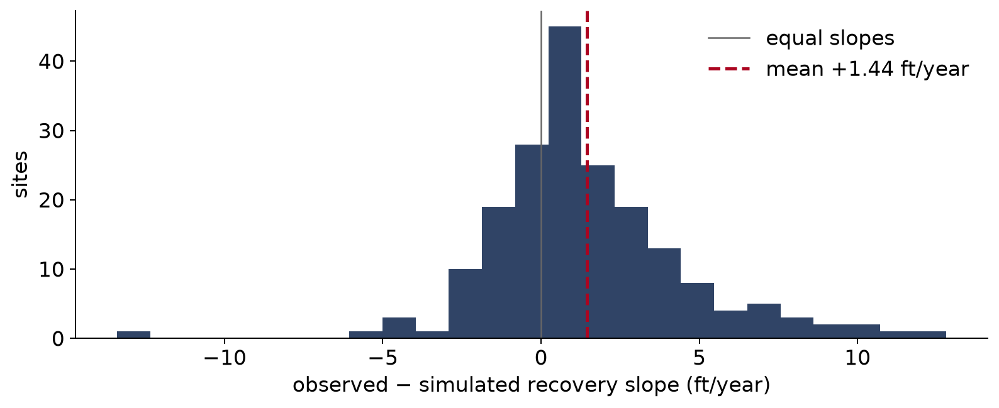
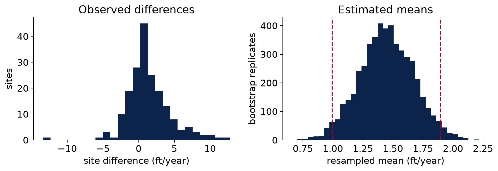
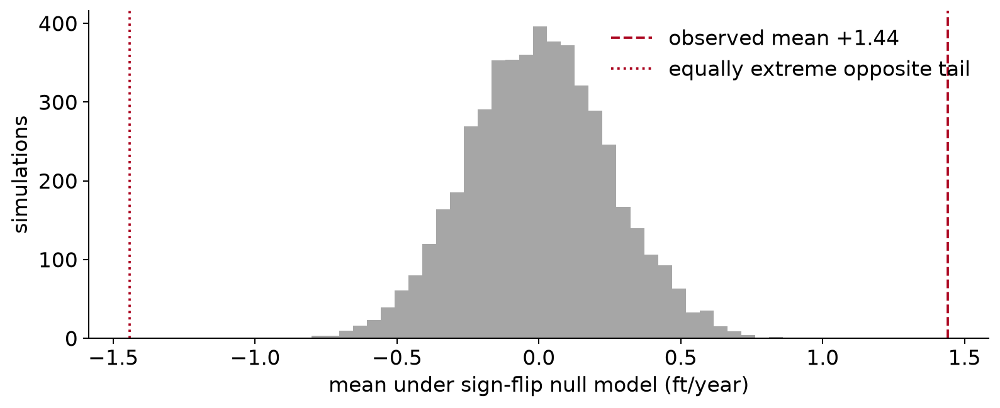

## The Pinal recovery comparison

**Does the model reproduce the recovery rates in its historical observations?**

Today: describe the differences, estimate uncertainty, and examine a specified null model.

Open [Lab 1 — Statistical evidence](../labs/week13/week13_01_statistical_evidence.ipynb).

The notebook needs only the committed CSVs. No download or MODFLOW run.

::: {.notes}
0–10 minutes: launch the investigation. Use the lab throughout, not as a second assignment after the lecture. Ask students to recall Week 12's observed and simulated recovery summaries. Today the comparison is explicitly paired at each model observation site. Timing: 10 min question; 12 min distributions; 10 min effects and weights; 18 min bootstrap; 15 min null demonstration; 10 min writing. All numerical results come from the committed HOB cache.
:::

# The observations {background-color="#0C234B"}

## Sample, population, and target quantity

| Term | In this investigation |
|---|---|
| Sample | 191 qualifying monitored sites |
| Broader population | Comparable sites we might want to describe |
| Statistic | Mean observed–simulated slope difference in our sample |
| Target quantity | Mean difference for a stated population of sites |

The records are not a random, area-balanced sample of the entire aquifer.

::: {.notes}
10–22 minutes, including the distribution slide. Population and sample need not be introduced through probability integrals. Ask which sites qualify and which parts of the basin the monitoring network might miss. The mean for these exact 191 computed slopes is descriptive and known; sampling uncertainty requires a generalization model.
:::

## One site contributes one paired difference

Both slopes use **the same observation times**, during **1985 ≤ year < 2005**.

A site needs at least **5 observations spanning 10 years**.

$$d_i=b_{obs,i}-b_{sim,i}\qquad\text{[ft/year]}$$

Positive: the simulation has a smaller recovery slope.

Each site receives equal weight. Weighting by observation count answers a different question.

::: {.notes}
These are head elevations, unlike the depth-to-water observations in part of Week 12. Positive head slope already means rising water, with no minus sign. A site may decline during the chosen recovery window. Two thousand records at one well do not create two thousand independent wells. Spatial dependence may remain even after reducing each site to one slope difference.
:::

## The differences vary substantially among sites

{fig-alt="Histogram of 191 observed minus simulated recovery slopes, with zero and mean +1.44 ft/year marked." width="90%"}

Mean **+1.44** · median **+0.95** · sample SD **3.15 ft/year**

## Your turn: calculate and interpret an effect

Illustrative eight-site data; use the full table in **Lab 1, task 1**.

```{pyodide}
#| exercise: ex_gap
import numpy as np
observed = np.array([1., 2., 4., 6., 0., 3., 5., 7.])
simulated = np.array([2., 2., 3., 4., 1., 2., 3., 4.])

d = ______
print("mean difference (ft/year):", ______)
```

::: {.hint exercise="ex_gap"}
Subtract simulated slopes from observed slopes, then average the differences.
:::

::: {.solution exercise="ex_gap"}
```python
import numpy as np
observed = np.array([1., 2., 4., 6., 0., 3., 5., 7.])
simulated = np.array([2., 2., 3., 4., 1., 2., 3., 4.])

d = observed - simulated
print("mean difference (ft/year):", d.mean())
```
The mean is +0.875 ft/year. This describes slopes; it does not establish an offset in head.
:::

::: {.notes}
22–32 minutes: do the small live exercise or move directly to lab task 1. Lab task 2 compares equal-site and observation-count weights. Ask students to predict the effect of a densely monitored well before running it. Mean, median, and SD describe different aspects of the distribution; SD is not an uncertainty interval for the mean.
:::

# Uncertainty in the average {background-color="#AB0520"}

## Spread and sampling uncertainty

**Spread among sites:** how different are their recovery discrepancies?

**Uncertainty in the mean:** how much might our estimate vary if we sampled comparable sites again?

A bootstrap resamples **site differences with replacement**, recalculating their mean each time.

The method approximates a sampling process; it does not create new field information.

::: {.notes}
32–50 minutes. Demonstrate a single replacement draw with an eight-site array. Some sites appear more than once and others are absent. Explain the distribution of estimates before introducing percentiles. Distinguish uncertainty about a broader population from variation in a fixed list of recorded slopes.
:::

## Your turn: one bootstrap replicate

The data below are illustrative. Repeat this operation in **Lab 1, task 3**.

```{pyodide}
#| exercise: ex_boot
import numpy as np
d = np.array([-1., 0., 1., 2., -1., 1., 2., 3.])
rng = np.random.default_rng(56413)

sample = rng.choice(d, size=______, replace=______)
print("resampled values:", sample)
print("resampled mean:", ______)
```

::: {.hint exercise="ex_boot"}
Keep the original sample size, allow repeats, and average the draw.
:::

::: {.solution exercise="ex_boot"}
```python
import numpy as np
d = np.array([-1., 0., 1., 2., -1., 1., 2., 3.])
rng = np.random.default_rng(56413)

sample = rng.choice(d, size=len(d), replace=True)
print("resampled values:", sample)
print("resampled mean:", sample.mean())
```
:::

## Resampled means have their own distribution

{fig-alt="Observed site differences and bootstrap mean differences on separate horizontal scales; bootstrap means have less spread." width="90%"}

Same physical units; different quantities. The horizontal scales differ.

## An approximate 95% interval

Mean gap **+1.44 ft/year**; percentile interval **[+1.00, +1.90] ft/year**.

The interval uses the 2.5th and 97.5th percentiles of resampled means.

A confidence procedure aims to cover the population quantity in 95% of repeated samples **when its assumptions hold**.

It does not contain 95% of individual site differences.

::: {.notes}
Do not describe the realized interval as assigning a 95% probability to a fixed parameter. A percentile bootstrap is approximate; do not claim exact coverage. With the seed and 5,000 replicates in the lab, students should reproduce the displayed endpoints. More Monte Carlo replicates reduce simulation noise, not sampling bias.
:::

## What the bootstrap leaves out

- Nearby wells may respond together: the independent-site assumption can fail.
- The network's locations may not represent the broader aquifer.
- Site slopes have their own estimation errors.
- Groundwater-model inputs and structure have additional uncertainty.

This interval is an **instructional calculation under independent-site sampling**.

::: {.notes}
Ask students which assumption they can examine with a map and which requires an alternative sampling model. Spatial block resampling is a possible extension, but do not add a second bootstrap implementation during this lecture. Sampling uncertainty and model structural uncertainty are not interchangeable.
:::

# A specified null model {background-color="#0C234B"}

## No systematic difference, with explicit assumptions

For a demonstration, assume independent differences **symmetric around zero**.

Conditional on each magnitude, positive and negative signs are equally plausible.

Random sign flips generate possible means under this null model.

A zero mean alone does **not** justify sign flipping. These observational data were not randomized.

::: {.notes}
50–65 minutes: instructor-led demonstration. Symmetry and independence are assumptions for this sign-flip construction, not discoveries established by the data. Use it to explain a null distribution. Treat inference for the real Pinal sample as conditional and illustrative, not a formally validated significance claim.
:::

## The null distribution is centered near zero

{fig-alt="Sign-flip null means centered near zero with the observed mean and equally extreme opposite tail marked." width="90%"}

The bootstrap estimates uncertainty around the observed effect; this simulation asks about a zero-centered null model.

## Your turn: count both tails

Illustrative simulation output; **Lab 1, task 4** uses 5,000 replicates.

```{pyodide}
#| exercise: ex_p
import numpy as np
null = np.array([-1.4, -0.8, -0.3, 0., 0.1, 0.4, 0.9, 1.5])
observed_mean = 1.0

n_extreme = np.count_nonzero(______ >= abs(observed_mean))
p = (n_extreme + 1) / (len(null) + 1)
print(n_extreme, p)
```

::: {.hint exercise="ex_p"}
Use the absolute values of the simulated means to include both tails.
:::

::: {.solution exercise="ex_p"}
```python
import numpy as np
null = np.array([-1.4, -0.8, -0.3, 0., 0.1, 0.4, 0.9, 1.5])
observed_mean = 1.0

n_extreme = np.count_nonzero(np.abs(null) >= abs(observed_mean))
p = (n_extreme + 1) / (len(null) + 1)
print(n_extreme, p)
```
Two exceedances; p = 3/9. The +1 correction avoids reporting zero from finite simulation.
:::

## What a p-value can establish

Under the specified null model, how often is the statistic **at least as extreme** as the observed one?

For the illustrative Pinal sign-flip model: Monte Carlo **p = 0.00020**, using **5,000 simulations**.

It is not the probability that the null is true, the effect size, or evidence identifying a cause.

A non-small p-value would not establish model agreement.

## Detectability and hydrologic importance

A small discrepancy can be detectable with abundant independent information.

A consequential discrepancy can be difficult to detect with sparse or dependent observations.

**Discussion:** what decision would make a difference of 1 ft/year important? Over what duration could a constant-rate comparison be reasonable?

::: {.notes}
Briefly name false positives and missed effects if useful: significance testing is fallible, and power depends on effect, noise, and independent information. Do not add formal power calculations. Do not extrapolate this linear discrepancy to 2115 as a physical forecast.
:::

## A conclusion with limits

**Lab 1, final discussion · 65–75 minutes**

1. State the effect, sign, units, period, and sites described.
2. Give the illustrative interval and independent-site assumption.
3. Interpret the null-model result conditionally.
4. Name a limitation on using this result for future predictions.

Thursday: the regressions and model errors behind these summaries.

::: {.notes}
Have pairs exchange four-sentence conclusions. Look for claims that all basin wells behave alike, that the model is invalid, or that pumping or recharge is proven to be the cause. The data support evaluation of calibration performance. No new submission deadline is introduced by this lab.
:::

## References and data

Pinal HOB cache: `data/cache/pinal_model_head_obs.csv`.

Derived slopes: `data/week13_pinal_recovery_slopes.csv`; rebuild with `python scripts/prepare_week13_data.py`.

Conceptual sequence informed by Pestana, Lundquist, and contributors, *Data Analysis in Water Sciences*: [sampling and distributions](https://mountain-hydrology-research-group.github.io/data-analysis/modules/module1/lab1-2.html) and [Monte Carlo methods](https://mountain-hydrology-research-group.github.io/data-analysis/modules/module2/lab2-4.html).

The paired Pinal investigation and independent-site bootstrap are instructional adaptations for this class.

::: {.notes}
Static data figures can be regenerated with `python scripts/plot_week13_figures.py`. Every displayed code example includes its own imports and input values; live exercises have no hidden setup cells.
:::
